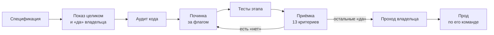
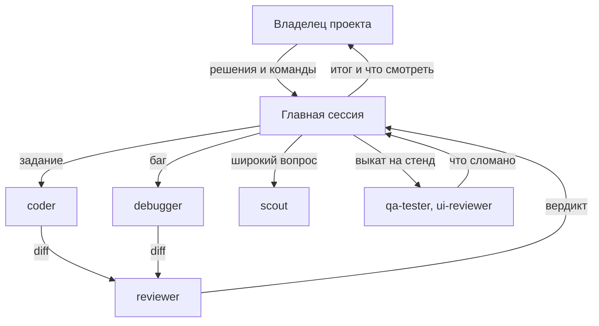

<div align="center">

# 🧭 Agent Rules

**Правила, скиллы и агенты Claude Code для разработки любого продукта**

От задачи до приёмки: как находить корень бага, доказывать результат, резать работу на этапы и беречь контекст.


[Быстрый старт](#-быстрый-старт) · [Что внутри](#-что-внутри) · [Как идёт работа](#-как-идёт-работа) · [Инструкция для агента](#-инструкция-для-агента) · [Что нужно от проекта](#-что-нужно-от-проекта)

</div>

---

Обычно агент уверенно говорит «готово», чинит симптом вместо причины и пишет больше кода, чем нужно. Этот набор задаёт ему рабочий процесс: что делать самому, о чём спрашивать, чем доказывать результат и кто проверяет рискованные правки.

Всё, что зависит от проекта, лежит в одном файле, `project.md`. Остальное одинаково для любого продукта.

## ⚡ Быстрый старт

Открой Claude Code в своём проекте и отправь:

```text
Прочитай README репозитория https://github.com/Aar0nWalker/Agent-Rules и внедри правила
в этот проект по разделу «Инструкция для агента».
```

Агент покажет план и дождётся твоего «да», поставит файлы, заполнит `project.md` по коду и спросит только то, чего не смог узнать сам. Затем открой новую сессию: правила подхватятся при старте.

## 💡 Главные идеи

| Идея | Что это значит |
|:---|:---|
| **Корень, а не случай** | Любой баг это экземпляр класса. Чиним правило, которого не было, а не одну запись |
| **Доказательство, а не «готово»** | Результат подтверждает ручной проход на тестовом стенде и вывод проверок, а не слова агента |
| **Тесты только по команде** | Без команды владельца проекта тесты не пишутся и не запускаются, кроме тестов этапа |
| **Этап показывают до кода** | Сначала весь путь глазами пользователя и «да» владельца, потом код |
| **Ревью по риску** | Деньги, доступ, промпты и удаление данных проверяет свежий контекст, а не автор |
| **Простота** | Сначала вопрос «нужно ли это вообще», затем готовое из проекта и минимум кода |
| **Контекст стоит денег** | Главная сессия решает и сливает, агенты читают и правят |

## 📦 Что внутри

```text
├── rules/       короткие правила, действуют всегда
├── skills/      подробные процедуры, подключаются по задаче
├── agents/      агенты по ролям
├── commands/    команда /test
└── templates/   project.md, CLAUDE.md, страница этапа, журнал багов, таблица приёмки
```

<details open>
<summary><b>Правила</b> · <code>rules/</code></summary>

| Файл | О чём |
|:---|:---|
| [`working-mode`](rules/working-mode.md) | когда делать самому, когда спрашивать, как отчитываться |
| [`root-cause`](rules/root-cause.md) | корень, а не случай; баг как класс; когда баг закрыт |
| [`simplicity`](rules/simplicity.md) | лестница решения, короткий diff, без защит «на всякий случай» |
| [`proof-and-tests`](rules/proof-and-tests.md) | доказательство результата, тесты только по команде |
| [`review`](rules/review.md) | ревью по риску, приёмка, круги возвратов |
| [`git`](rules/git.md) | ветки, деревья, слияние, история |
| [`flags-rollout`](rules/flags-rollout.md) | флаги, тестовый стенд, прод |
| [`permissions`](rules/permissions.md) | деньги, платные вызовы, секреты, сообщения клиентам |
| [`prompts`](rules/prompts.md) | правка промпта вписывается в целое |
| [`agents-cost`](rules/agents-cost.md) | кому отдать задачу, какая модель, расход контекста |

</details>

<details>
<summary><b>Скиллы</b> · <code>skills/</code></summary>

| Группа | Скилл | Когда |
|:---|:---|:---|
| Код | [`debugging`](skills/debugging/SKILL.md) | любой баг или сбой |
| | [`code-review`](skills/code-review/SKILL.md) | перед выкатом, после правок агента |
| | [`planning`](skills/planning/SKILL.md) | разбивка работы на задачи |
| | [`incremental-implementation`](skills/incremental-implementation/SKILL.md) | правки малыми проверяемыми шагами |
| | [`task-writing`](skills/task-writing/SKILL.md) | задача для исполнителя-человека |
| Этапы | [`stage-development`](skills/stage-development/SKILL.md) | разработка и приёмка этапа |
| Безопасность | [`security-hardening`](skills/security-hardening/SKILL.md) | авторизация, платежи, ключи, загрузки |
| | [`security-best-practices`](skills/security-best-practices/SKILL.md) | ревью безопасности по языку и фреймворку, по прямой просьбе |
| Промпты | [`prompt-review`](skills/prompt-review/SKILL.md) | правка промпта или его сборки |
| Интерфейс | [`ui-principles`](skills/ui-principles/SKILL.md) | перед любой правкой интерфейса |
| | [`ui-heuristics`](skills/ui-heuristics/SKILL.md) | финальная сверка экрана, жалоба «неудобно» |
| | [`ui-design-references`](skills/ui-design-references/SKILL.md) | внешние образцы стиля и компонентов |
| | [`frontend-ui-engineering`](skills/frontend-ui-engineering/SKILL.md) | стандарт окна, вёрстка, визуальная проверка |
| | [`frontend-e2e`](skills/frontend-e2e/SKILL.md) | e2e, только по команде или как тесты этапа |

</details>

<details>
<summary><b>Агенты</b> · <code>agents/</code></summary>

| Агент | Модель | Что делает |
|:---|:---|:---|
| [`coder`](agents/coder.md) | Sonnet, на сложном Opus | правки кода в своём дереве |
| [`debugger`](agents/debugger.md) | Opus | ведёт баг целиком: диагноз, решения, фикс после «да» |
| [`scout`](agents/scout.md) | Haiku | только широкая разведка, ничего не правит |
| [`reviewer`](agents/reviewer.md) | Opus | ревью рискованного diff свежим контекстом |
| [`ui-reviewer`](agents/ui-reviewer.md) | Opus | экран глазами пользователя, скрины до и после |
| [`qa-tester`](agents/qa-tester.md) | Opus | проходит продукт как человек, команда `/test` |

</details>

## 🔄 Как идёт работа

Большая страница или функция режется на этапы. Каждый этап проходит один и тот же путь:



Подробно: [`stage-development`](skills/stage-development/SKILL.md).

Роли при обычной работе:



## 🤖 Инструкция для агента

Выполняй по порядку. Работай в проекте, куда ставишь правила.

**Шаг 1. Получи набор** во временную папку вне проекта и запомни его SHA:

```bash
SET=$(mktemp -d)
git clone https://github.com/Aar0nWalker/Agent-Rules "$SET"
git -C "$SET" rev-parse --short HEAD
```

**Шаг 2. Посмотри, что уже есть в проекте:**
- основной файл инструкций: `CLAUDE.md`, `.claude/CLAUDE.md` или `AGENTS.md`;
- файлы с совпадающими именами в `.claude/rules`, `.claude/skills`, `.claude/agents`, `.claude/commands`;
- не игнорирует ли git новые папки: `git check-ignore docs/stages/x docs/bugs/x docs/plans/x .claude/rules/x`.

**Шаг 3. Покажи владельцу проекта план и дождись «да».** Что добавится, какие файлы совпали, какие папки игнорируются, какие правила проекта спорят с набором. Спор не решай молча: правила проекта важнее набора, пока владелец не скажет иначе.

**Шаг 4. Скопируй файлы** из корня проекта. Флаг `-n` не перезаписывает существующее, совпавшие файлы заменяй только по слову владельца:

```bash
mkdir -p .claude/templates docs/bugs docs/stages docs/plans
cp -rn "$SET"/rules "$SET"/skills "$SET"/agents "$SET"/commands .claude/
cp -n "$SET"/templates/stage-spec.md "$SET"/templates/bug-journal.md "$SET"/templates/acceptance-table.md .claude/templates/
cp -n "$SET"/templates/project.md .claude/
```

Подключи правила к инструкциям проекта:
- файла инструкций нет: `cp "$SET"/templates/CLAUDE.md .claude/`;
- файл есть: допиши в него текст `templates/CLAUDE.md`. Строка `@project.md` считается от файла, где написана: в корневом файле пиши `@.claude/project.md`.

Папка игнорируется git: с разрешения владельца добавь исключение в `.gitignore` (`!docs/stages/`) либо возьми другую папку и запиши её в `project.md`. В `.gitignore` также нужен `.claude/worktrees/`.

**Шаг 5. Заполни `.claude/project.md`.** Основную ветку, папки, команды проверок бери из кода и настроек проекта. В строку «Версия правил» запиши SHA из шага 1. Неизвестное спроси одной пачкой. Секреты в файл не пиши, только где их взять.

**Шаг 6. Проверь команду типов.** Временно добавь заведомо ошибочную строку в свою копию файла, запусти команду из `project.md`, убери строку. Команда промолчала или зависимостей нет: скажи владельцу и отметь в `project.md` «не проверено».

**Шаг 7. Отчитайся** владельцу: что поставлено, что заменено, какие споры с правилами проекта, что осталось пустым в `project.md`. Попроси открыть новую сессию и проверить: `/memory` показывает файлы из `.claude/rules/`, `/agents` показывает `coder`, `reviewer` и остальных. Удали `"$SET"`. Не коммить без его команды.

### Обновление

Получи новую копию набора полной историей и покажи владельцу, что изменилось с SHA из `project.md`: `git -C "$SET" log <SHA>..HEAD`, `git -C "$SET" diff <SHA> HEAD --stat`. Сравни изменённые файлы с теми, что лежат в `.claude/`: локальные правки не затирай без слова владельца. После «да» скопируй изменённые файлы и обнови SHA. `project.md` при обновлении не трогается: свои добавления держи там.

## 🧩 Что нужно от проекта

Набор задаёт процесс, а знания о продукте даёт сам проект. Результат зависит от того, что будет заполнено:

| Что | Зачем | Если нет |
|:---|:---|:---|
| Заполненный `project.md` | команды, ветка, адреса, языки | агент спрашивает или угадывает |
| Описание продукта и решения владельца | спецификация этапа опирается на них, а не только на код | в разделе «Дыры» будет больше вопросов, возможны неверные правила |
| Журнал багов `docs/bugs/` | класс бага и прошлые фиксы | старые ошибки повторяются |
| Тестовый стенд и служебный аккаунт | ручное доказательство результата | локальный запуск; что считать доказательством, запиши в `project.md` |
| Установленные зависимости | настоящая проверка типов | ошибки находятся только при сборке |

## 🧰 Требования

- Claude Code с доступом к Sonnet, Opus и Haiku. Модели другие: поменяй поле `model` у агентов.
- Для `qa-tester` и `ui-reviewer` браузерный инструмент, по умолчанию `playwright-cli`, запиши его в `project.md`.
- Для `skills/frontend-ui-engineering/tools/screenshot.py`: `pip install playwright`.
- Необязательно: [`rtk`](https://github.com/rtk-ai/rtk) сокращает вывод команд до того, как он попадёт в контекст.

Скилл `security-best-practices` на английском, остальной набор на русском.

## 🛠 Первая работа после установки

Загрузи скилл `stage-development`, разбей страницу на этапы, опиши первый этап по `templates/stage-spec.md`, покажи его владельцу проекта целиком и после его «да» начинай код.

## 📄 Лицензия

[MIT](LICENSE). Часть материалов основана на чужих открытых проектах, авторы и лицензии перечислены в [THIRD_PARTY_NOTICES.md](THIRD_PARTY_NOTICES.md).
